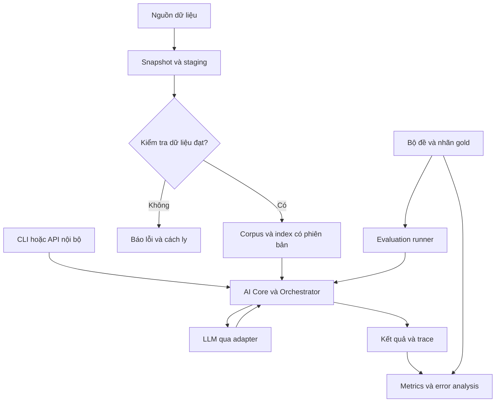
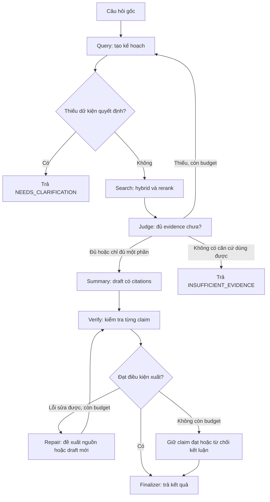
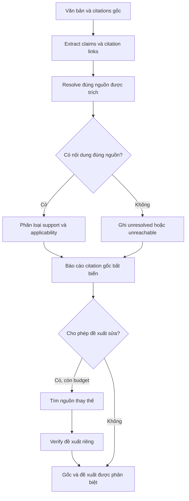

# Bản đồ hệ thống và luồng chương trình

## 1. Ba hoạt động khác nhau

- **Chuẩn bị dữ liệu (offline):** đưa văn bản đã kiểm tra vào kho, tạo chỉ mục. Chạy trước hoặc khi cập nhật corpus.
- **Xử lý yêu cầu (runtime):** đọc kho và gọi model để trả lời/kiểm chứng một request. Không sửa kho luật.
- **Đánh giá (evaluation):** chạy cấu hình trên bộ đề có đáp án/nhãn người kiểm tra rồi tính điểm. Không phải agent tự chấm mình là đúng.

FE/BE là khách gọi API của AI Core. Lúc học, CLI đọc một JSON và in JSON kết quả, nên không phải đợi web xong. Một tiến trình Python đủ chạy các module logic ban đầu.

## 2. Luồng A: Project 1 hỏi đáp có kiểm chứng

Mọi nhánh quay lại đều qua budget guard trong code. Sơ đồ rút gọn: lỗi schema/provider tại bất kỳ node nào chuyển sang error handler, retry hữu hạn hoặc kết thúc có lý do. Judge thiếu bằng chứng chỉ được vào Summary ở chế độ partial khi đã hết đường bổ sung và có phần riêng biệt đủ căn cứ; không tạo kết luận toàn phần từ tập thiếu.

Trình tự cụ thể:

1. Nhận request, validate độ dài/chế độ/ngày, khởi tạo state theo `request_id`.
2. Query trích ý định, vấn đề cần giải quyết, các thông tin người dùng đã cho và các câu hỏi cần làm rõ. Không tự điền sự kiện làm thay đổi kết luận.
3. Search chạy BM25 và dense trên cùng corpus version; fusion, dedupe, rerank rồi chọn context. Tra mã điều/văn bản rõ ràng bằng exact lookup trước khi semantic search.
4. Judge xem từng issue có nguồn hỗ trợ, đúng phạm vi, phù hợp thời điểm, có ngoại lệ/mâu thuẫn chưa giải quyết không. `evidence_count >= 2` không phải luật sufficiency.
5. Nếu thiếu và còn ngân sách: tạo truy vấn cho đúng gap; query lặp không đổi và không thêm evidence thì dừng vì `no_progress`.
6. Summary sinh draft có cấu trúc: câu trả lời chia thành claim, mỗi claim tham chiếu evidence ID đã tồn tại. Renderer điền citation/URL từ metadata; LLM không tự tạo URL.
7. Verify kiểm tra lại các claim trong văn bản cuối draft. Không tin hoàn toàn danh sách claim tự khai của generator; phải phát hiện cả câu có nội dung pháp lý bị bỏ khỏi danh sách.
8. Nếu citation sai: lưu kết quả gốc, cân nhắc sửa một lần. Mọi claim/citation đổi phải được kiểm tra lại. Nếu chỉ giữ các claim đạt, renderer ghép nguyên văn các claim đó với câu giới hạn cố định, không gọi thêm model để viết câu chưa được kiểm chứng.
9. Trả status, answer, citation report, limitations và stop reason. Log không gọi `SUCCESS` chỉ vì HTTP trả 200.

## 3. Luồng B: Project 9 kiểm chứng văn bản đầu vào

Không cần bắt luồng này đi qua Summary để tạo câu trả lời pháp lý mới. Query và Evidence Judge có thể dùng để giải nghĩa yêu cầu/giải quyết source gaps, nhưng nhãn cuối do verifier nguồn cụ thể quyết định. Trước tiên kiểm tra citation A; nếu B hỗ trợ claim, báo A không đạt và B là đề xuất, không sửa lịch sử A thành đúng.

## 4. Module nào làm gì?

| Module | Đầu vào | Đầu ra | Dùng LLM? | Cách tự kiểm tra |
|---|---|---|---|---|
| Request validator | JSON người gọi | Request hợp lệ hoặc lỗi | Không | Thiếu mode, input quá dài, ngày sai |
| Query planner | Câu hỏi gốc, context cần thiết, gaps | QueryPlan | Có thể | Không đổi câu gốc; không tự thêm sự kiện |
| Search | Queries, filters, corpus version | Evidence + ranking + errors | Thường không | Đúng nguồn, cùng phiên bản, Recall@5 |
| Evidence Judge | Issues + evidence + scope | Sufficiency + gaps + usable IDs | Thường có | Hai tài liệu sai vẫn phải thiếu; một điều đủ có thể đủ |
| Summary | Câu hỏi + evidence được chọn | Structured draft | Có | Mọi citation ID tồn tại; không bịa URL |
| Claim extractor | Văn bản draft hoặc văn bản người dùng | Atomic claims, spans | LLM + kiểm tra span | Không bỏ điều kiện/ngoại lệ; đo extraction recall |
| Citation parser/linker | Văn bản + claims | Raw citation, locator, links | Regex/rules + LLM khi mơ hồ | Một citation cho nhiều claim; Điều 5 chưa biết luật nào |
| Source resolver | Citation + version/date | Đúng source hoặc unresolved | Chủ yếu code/search | Similarity cao không thay thế exact identity |
| Support verifier | Một claim và đúng cited evidence | Support label + quote + lý do ngắn | Có | Evidence sai số, thiếu điều kiện, không liên quan |
| Applicability checks | Metadata + as_of_date + scope | Identity/temporal/jurisdiction status | Code + thẩm định khi cần | Missing date thành UNKNOWN, không thành VALID |
| RepairSearch | Claim + lỗi + budget | Candidate mới có provenance | Có thể | Không ghi đè nguồn/verdict gốc |
| Orchestrator | State + node result | State mới + node tiếp | Không cần | LLM không sửa được budget/counter |
| Finalizer | Draft + report | Response an toàn theo policy | Không | Không phát sinh claim mới sau Verify |

Tên agent dùng để diễn đạt trách nhiệm. Lúc đầu có thể là `plan_query()`, `retrieve()`, `judge_evidence()`, `draft_answer()`, `verify_document()`. Không cần mỗi tên một model/API call.

## 5. Ví dụ hoàn toàn giả lập để học

Nguồn `DEMO-A`, Điều 3: “Người tham gia loại X được nghỉ 2 ngày khi đáp ứng điều kiện Y.” Đây **không phải luật Việt Nam**, chỉ là fixture.

Input cần kiểm chứng: “Tất cả người tham gia đều được nghỉ 5 ngày theo Điều 3 DEMO-A.”

- Extract: một claim với lượng từ “tất cả”, số “5 ngày”; citation raw giữ nguyên.
- Resolve: lấy đúng Điều 3 DEMO-A, không tìm một điều khác có chữ “5 ngày”.
- Verify: source không hỗ trợ khẳng định; reason codes `NUMERIC_MISMATCH`, `MISSING_CONDITION`.
- Nếu tìm được DEMO-B nói 5 ngày: verdict DEMO-A vẫn không đạt; DEMO-B là candidate riêng và cần kiểm tra đối tượng/thời điểm.
- Nếu source fetch timeout: `source_status=UNREACHABLE`, support chưa chấm; không gọi đó là chứng minh claim sai.

## 6. Quyết định công nghệ

Thiết kế mặc định để giảm số khái niệm phải học cùng lúc: Python + typed schemas/Pydantic, pytest, CLI; file JSONL/SQLite cho prototype nhỏ; BM25 baseline; dense retrieval và reranker thông qua adapter; orchestrator Python tường minh. Model/SDK/version cụ thể được Codex kiểm tra tài liệu chính thức và khóa trong lockfile ở thời điểm triển khai.

Sau khi hiểu state và có workflow tests, có thể chuyển orchestration sang LangGraph và chạy cùng tests để chứng minh tương đương. Khi tích hợp, ưu tiên đánh giá PostgreSQL + pgvector cùng nhóm, không mang thêm database chỉ để đủ tên công nghệ. FastAPI mỏng chỉ xuất `answer_question`/`verify_citations`, health và JSON schema; không làm auth người dùng, CRUD hội thoại hay UI ở nhiệm vụ này.

Dense model và reranker phải đọc được tiếng Việt, phù hợp RAM/GPU/giấy phép. Chọn trên dev set, ghi model revision và thời gian chạy, không chốt model vì đứng đầu một bảng xếp hạng khác. Không fine-tune ở MVP; benchmark lỗi trước khi quyết định có cần huấn luyện.
