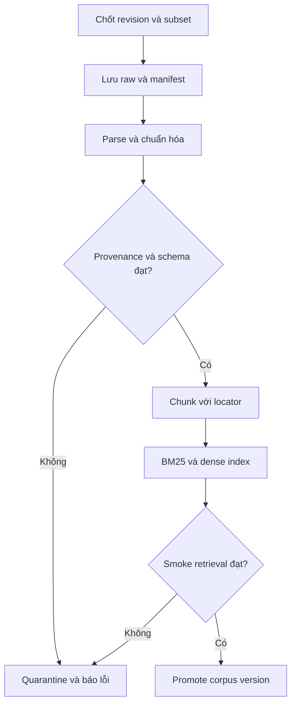

# Dữ liệu: quyết định và quy trình kiểm tra

## Quyết định

Dùng dataset Hugging Face được đề xuất làm **ứng viên corpus ban đầu**, chưa dùng toàn bộ làm kho luật đáng tin cậy. Chỉ đưa một subset đã audit vào chỉ mục. Bộ evaluation phải tự xây riêng với nhãn người kiểm tra; văn bản luật thô không có sẵn đáp án cho bài kiểm chứng citation.

Nguồn xem ngày 14/10/2026: https://huggingface.co/datasets/th1nhng0/vietnamese-legal-documents . Theo card: nguồn thu thập VBPL, license khai báo CC BY 4.0; config `content` chứa `id` và `content_html`, ghép `metadata` bằng ID dạng chuỗi; có config `relationships`. Card nêu có metadata thiếu content và dữ liệu là snapshot. Viewer cũng hiện một mẫu body rỗng. Đây là quan sát card/mẫu, chưa phải audit toàn bộ dữ liệu.

Không trộn schema legacy với config hiện tại. Không lấy tổng row count của mọi config làm số văn bản luật duy nhất. Codex phải đọc schema của revision thực sự tải, khóa commit/revision và ghi manifest trước khi chạy ingestion.

## Quy trình audit do nhóm thực hiện

1. Kiểm tra dataset card, revision, điều kiện sử dụng và cách ghi attribution. Ghi nguồn upstream; không tự suy rộng tuyên bố của card về quyền sử dụng sang mọi loại tài liệu.
2. Chọn phạm vi câu hỏi nhỏ và danh mục văn bản dự kiến cần; xác minh danh mục với nguồn chính thức. Chưa khẳng định số hiệu/ngày hiệu lực bằng trí nhớ model.
3. Tải metadata cần thiết và subset content phù hợp, không tải tất cả cho bài học đầu. Lấy 30 mẫu để khám phá lỗi: 20 trong phạm vi, 10 có cấu trúc khó/thiếu trường; đây là sample có chủ đích, không ước lượng tỷ lệ lỗi toàn corpus.
4. Ghép bằng key string; kiểm tra key thiếu/trùng, join cardinality, orphan relationships. Giữ riêng record không ghép được, không silently drop.
5. Mở raw HTML và bản text đã parse của từng mẫu cạnh nhau. Giữ số điều, khoản, điểm, bảng, số tiền, phủ định, điều kiện, ngoại lệ; gắn cờ văn bản rỗng hoặc bị cắt.
6. Đối chiếu mẫu với nguồn upstream đã resolve đúng. `source_url` phải là URL đã quan sát/xác minh, không ghép số ID thành URL rồi giả định nó tồn tại. Chưa resolve được thì để null và UNVERIFIED_PROVENANCE.
7. Chuẩn hóa metadata; ngày thiếu là null/UNKNOWN. Trạng thái “còn hiệu lực” tại ngày crawl không tự chứng minh áp dụng đúng tại `as_of_date` của người dùng. Sửa đổi từng phần cần mô hình hóa hoặc giới hạn rõ coverage.
8. Chỉ promote tài liệu đạt gate vào `corpus-v1`; lưu rejection report. Mở rộng từ khoảng 10 văn bản đã duyệt đến 30–50 khi pipeline và nhãn ổn định. Đây là quy mô học đề xuất, không phải ngưỡng môn.

## Data contract cho audit report

Một record audit gồm `source_record_id`, dataset_revision, document_number, raw_hash, raw_path, parse_status, missing_fields, source_url, source_checked_at, source_match, temporal_check_status, issues[], reviewer, decision (ACCEPT/QUARANTINE), decision_reason.

Thống kê tối thiểu: số records nhận/ghép được/rỗng/trùng/parser lỗi; tỷ lệ có document number, locator, URL xác minh; số metadata chưa đủ về hiệu lực; số ACCEPT/QUARANTINE. Không đặt gate “98% sạch” khi chưa biết phân bố. Gate cứng của subset đưa vào demo: mỗi record được index phải có provenance và locator dùng được; thiếu gì phải phản ánh trong khả năng trả lời.

## Chunking để citation không mất địa chỉ

Ưu tiên cấu trúc văn bản → chương → điều → khoản → điểm. Lưu heading và parent. Điều quá dài thì chia theo khoản/đoạn với giới hạn token, giữ chunk→parent và offset. Search có thể trả child chunk nhưng resolver được phép đọc parent cùng điều để không bỏ điều kiện. Không cắt phủ định khỏi câu hoặc biến bảng thành dãy số mất cột.

Không sao chép máy móc kích thước chunk từ paper. Benchmark trên câu hỏi thật của nhóm. Citation tới “Điều 3” phải có thể tìm toàn bộ nội dung điều, không chỉ phần fragment tình cờ được retrieval xếp cao.

## Offline pipeline

Lưu SHA-256 đầy đủ cho bytes raw; thêm hash text chuẩn hóa riêng. Hash chứng minh bytes có đổi không, **không chứng minh nội dung pháp lý đúng**. Lưu thời điểm UTC, nguồn, HTTP status khi fetch, parser version và config.

Cập nhật: tạo staging version → validate → build index cùng version → smoke tests → đổi active pointer nguyên tử. Request đang chạy giữ version cũ đã pin đến khi kết thúc. Lỗi update thì giữ active version cũ. Retain ít nhất phiên bản trước để rollback; kiểm thử rollback. Cơ chế chạy theo ngày đáp ứng hướng tài liệu nhóm sau khi pipeline này ổn; không cần agent tự quyết định thay luật.

## Online search nằm ở đâu?

Không bắt buộc trong Ten Projects cho P1/P9. Phù hợp làm mở rộng khi corpus thiếu nguồn, cần tra tình trạng cập nhật hoặc sửa link. Baseline và final benchmark chính dùng snapshot cố định để tái lập; thí nghiệm online báo riêng và giữ evidence snapshot tại thời điểm chạy.

Web search chỉ tìm ứng viên. Fetch đúng trang gốc, kiểm tra identity, lưu provenance rồi mới Verify. Search snippet không đủ cho kết luận support chính thức của MVP. Nếu chỉ có snippet: UNVERIFIED, không được nâng thành full-text support.

Web evidence của request được lưu theo run; muốn nhập corpus thì tạo ingestion candidate và qua audit/promotion riêng. Verdict SUPPORTED của một claim không cấp quyền sửa knowledge base.

## Dữ liệu nào không được dùng làm gold?

Không lấy câu trả lời do chính hệ thống vừa sinh hoặc nhãn do cùng verifier tự sinh làm gold chưa kiểm tra. Không xem câu hỏi/đáp án văn bản của một dataset khác là tương thích ngay với thời điểm/corpus của mình. Không đưa đáp án test, giải thích gán nhãn hoặc annotation rationale vào retrieval corpus hay prompt few-shot.
